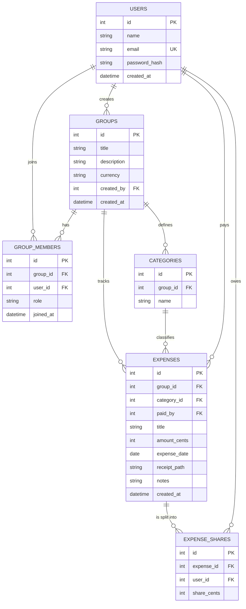

# Week 11 Checkpoint: Planning and Design

* **Project:** SplitMate - Shared Expenses & Group Budget Tracker
* **Team:** Vladyslav Olefir, Daryna Nevska
* **Date of checkpoint:** 27 November 2026
* **Repository:** https://github.com/YGetch/splitmate

## 1. Technology Choices

* Runtime and backend: Node.js with Express.js (modular routing, middleware, Post/Redirect/Get pattern).
* Templates and frontend: EJS server-side templates (shared partials for header, navigation, and footer; automatic output escaping against XSS) and external responsive CSS3 to be tested at 360px, 768px, and 1280px, plus a print stylesheet (`@media print`).
* Database: SQLite via the `better-sqlite3` driver using parameterized queries against SQL injection and enforced foreign keys.
* Security and utilities: `bcrypt` for password hashing, `express-session` for session management and session ID regeneration on login, custom CSRF token middleware, `multer` for receipt image uploads, and `cookie-parser` for a non-sensitive theme preference cookie.
* Version control: Git and GitHub (`https://github.com/YGetch/splitmate`).

## 2. Relational Data Model (ER Diagram)

The database schema (`database/schema.sql`) includes 6 relational tables with primary keys, foreign keys, `UNIQUE` and `CHECK` constraints, and referential actions:

* `ON DELETE CASCADE` when a group is removed (its members, categories, expenses and shares are removed with it).
* `ON DELETE RESTRICT` to prevent deleting categories, users or members that are linked to existing expenses.
* Composite foreign keys guarantee that the category of an expense belongs to the same group and that the payer is a member of that group.
* The rule that the shares of one expense add up to its amount cannot be expressed as a foreign key and is checked in the application code.
* The role (`creator` or `member`) is stored per group in `group_members`, because one user can be the creator of one group and an ordinary member of another.
* Money is stored as integer cents (`amount_cents`, `share_cents`) to avoid floating-point rounding errors in balance calculation.
* `expense_shares` stores who owes what for each expense; it is the basis of the "who owes whom" balance.

## 3. Work Plan (Weeks 11-14)

* Week 11 (Planning & Design): tech stack, SQLite schema and ER diagram (Vladyslav); site map and wireframes (Daryna).
* Week 12 (Database & Core Backend), by 1 December: initialize SQLite DB with seed data, user registration/login (bcrypt, sessions), role middleware, first working CRUD flow.
* Week 13 (Integrated Application), by 1 December: expense CRUD (PRG + delete confirmation), receipt uploads (multer), multi-criteria JOIN search, debt balance calculation, preference cookie, print report, CSRF/XSS/SQLi protections, responsive CSS.
* Week 14 (Testing & Release), before the submission deadline on 14 December: full test matrix, W3C HTML/CSS validation, clean-install ZIP check, technical report (6-10 pages), slides, 3-minute demo video.

## 4. Site Map and Access Levels

*To be added (Daryna): public area, authenticated member area, creator-only area.*

## 5. Wireframes

*To be added (Daryna): key pages saved in `docs/wireframes/` and listed here.*

